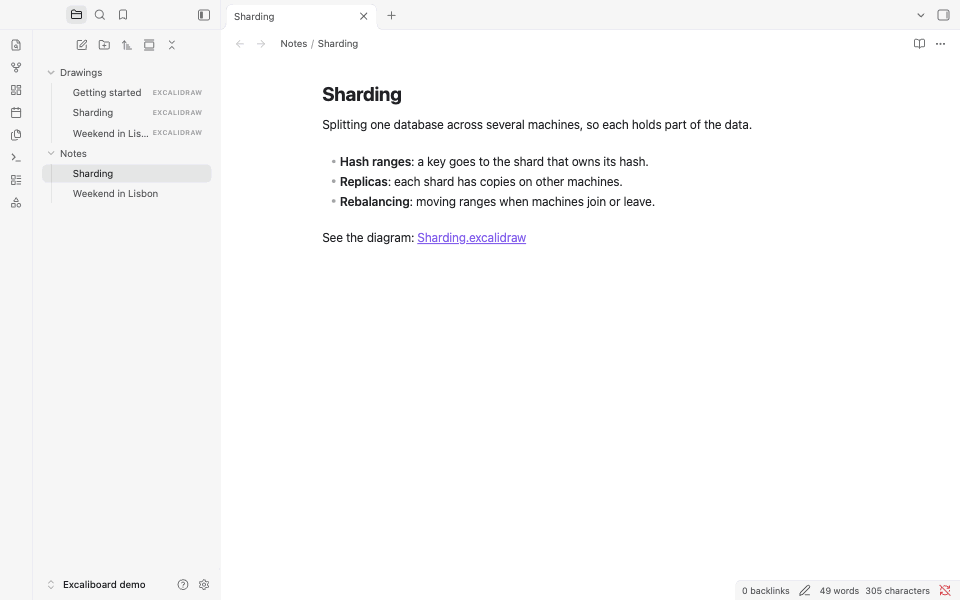
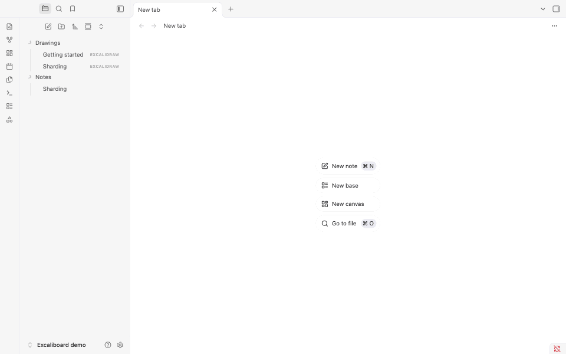

# Excaliboard

**Your drawings stay plain `.excalidraw` files that excalidraw.com opens, and Excaliboard writes one only after you
change it: opening, scrolling and zooming leave the file byte for byte as it was.**

Draw in your vault with the Excalidraw editor. Each drawing stays a plain .excalidraw file that excalidraw.com opens,
written only when you change it.

<p align="center">
  
</p>

Excaliboard opens `.excalidraw` files in the official Excalidraw editor, in an Obsidian tab. A drawing is an ordinary
file in your vault, in the JSON that excalidraw.com writes when you save to disk, so it opens there too, diffs in
git and syncs with whatever syncs your vault. Excaliboard adds no format of its own and keeps nothing in the drawing
that Excalidraw doesn't: what it remembers for you, such as where you left each drawing, stays in the plugin's folder.

## Features

- **The Excalidraw editor.** The official `@excalidraw/excalidraw` 0.18.1: its drawing tools, the hand-drawn fonts,
  frames, the laser pointer, the library (not kept yet: it lasts until Obsidian quits, so export what you want to keep
  from the library's menu, in the drawing you added it in), image export (PNG, SVG and the clipboard) and Excalidraw's
  own shortcuts.
  Web embeds, the AI tools and Mermaid import are left out.
- **Plain files.** A drawing is standard Excalidraw JSON, images included, with nothing added. Keys that another
  tool put at the top of the file are kept when Excaliboard saves it.
- **Written only when you change it.** Opening a drawing, scrolling, zooming and selecting never write the file. A
  change is saved 2 seconds later, when the tab closes and when you quit; Cmd/Ctrl+S saves at once.
- **A drawing is never lost.** Before its first save in a session, the drawing is copied to a session backup. A
  drawing that holds something this Excalidraw version can't read, such as the sticky notes excalidraw.com saves
  today, opens read-only and stays exactly as it is, instead of losing those parts on the next save.
- **Changes from elsewhere show up in place.** A change made by Obsidian Sync, iCloud, git or another tab appears in
  the open drawing. If you had unsaved edits too, yours are kept and saved, and the other version goes to the session
  backups.
- **At home in Obsidian.** New drawings from a folder's menu, the ribbon or the command palette; links on shapes that
  open your notes (`[[Note]]`) and websites; Export image in the tab's menu; your light or dark theme and your accent
  colour.
- **Each drawing as you left it.** The scroll position and zoom are kept for the 200 drawings you opened most recently,
  in the plugin's own data.
- **Offline.** The editor and its fonts are inside the plugin, and nothing goes online, not even the parts of
  Excalidraw that would ([How it works](#how-it-works)).
- **Drawings from your AI agent.** An agent skill teaches Claude, or another agent, to write drawings that open here
  ([For AI agents](#for-ai-agents)).

## How it compares

Several Obsidian plugins open and edit Excalidraw drawings. The table sets out what each one says about itself on its
page in the [community directory](https://community.obsidian.md/plugins) (read on November 7, 2026); "—" means the
page doesn't say.

| | Drawings are saved as | Editor | Previews in notes | Desktop and mobile | Network use |
| --- | --- | --- | --- | --- | --- |
| **Excaliboard** | `.excalidraw` files, in the plain JSON that excalidraw.com writes, images included | The official `@excalidraw/excalidraw` 0.18.1, without web embeds, the AI tools or Mermaid conversion; the fonts of its font picker, with CJK text in a system font | No | Desktop only | None |
| [Excalidraw](https://community.obsidian.md/plugins/obsidian-excalidraw-plugin) | Markdown files with the drawing inside, optionally compressed; compatibility settings for legacy `.excalidraw` files | Excalidraw | Yes | Yes | Optional: AI features, OCR, link titles, web images and script downloads; CJK fonts are downloaded from GitHub when needed |
| [Just Simple Excalidraw](https://community.obsidian.md/plugins/just-simple-excalidraw) | `.excalidraw` JSON files, images included | The official Excalidraw editor, in a lean build: no Mermaid conversion or web embeds, and one Latin font subset | No | Yes | None |
| [CanvasDraw](https://community.obsidian.md/plugins/canvas-draw) | `excalidraw` code blocks inside notes; pasted images as files in a `content/` folder | The Excalidraw editor, in a full-screen modal | Yes, as an image or a live canvas | Yes | — |
| [Excalidraw CN](https://community.obsidian.md/plugins/excalidraw-cn) | — | excalidraw-cn, a whiteboard based on Excalidraw with a Chinese handwriting font | — | Yes | — |

The others also do things Excaliboard doesn't: Excalidraw links drawings and notes both ways and adds scripts, LaTeX,
OCR and PDF export; Excalidraw CN links shapes to notes and adds table, mind map and Markdown cards; CanvasDraw keeps
a set of installed shape libraries; Just Simple Excalidraw takes a custom handwriting font and runs on phones.

## Getting started

### Open and create drawings

- **Open**: click a `.excalidraw` file in the file explorer, or open it from a link, the quick switcher or search.
- **New drawing**: right-click a folder in the file explorer and choose **New drawing** to make it in that folder.
  The ribbon button (the shapes icon) and the command **Excaliboard: Create new drawing** make it in the folder set in
  Settings > Excaliboard or, when that is empty, where Obsidian puts new notes. A new drawing is named after the
  time, for example `Drawing 2026-11-08 1402.excalidraw`, and opens in a new tab; rename it like any file.
- **Export an image**: **Export image** in the tab's **⋯** menu, or the command **Excaliboard: Export image**, opens
  Excalidraw's export dialog (PNG, SVG or the clipboard). The menu at the top left of the canvas has it too.
- **Link a shape to a note**: select the shape, press Cmd/Ctrl+K and type a note's name in double brackets, such as
  `[[Sharding]]`, or a web address with its `https://`. Click the link icon on the shape to open it; Cmd/Ctrl-click
  opens a note in a new tab. A note that doesn't exist yet is created, as from a link in a note. (Without `https://`,
  an address that starts with `www.`, has a path, or ends in .com, .org or another common ending still opens in the
  browser; anything else is taken for a note's name.)
- **Link a shape to another shape**: right-click a shape and choose **Copy link to object**, then paste that link on
  another shape. Clicking it scrolls to the first shape, here and on excalidraw.com.

<p align="center">
  
</p>

Only one plugin can open `.excalidraw` files. While another plugin that opens them is turned on (the community
Excalidraw plugin, Just Simple Excalidraw), it keeps them: choose **Open in Excaliboard** in a drawing's menu to open
one here. New drawings open in Excaliboard either way. When you turn that plugin off, Excaliboard takes the files.
To switch the other way, turn Excaliboard off first, then turn the other plugin on: while Excaliboard has the files,
the other plugin can't load, and Obsidian leaves it off. Turn Excaliboard back on afterwards if you like; it leaves
the files to the other plugin. With the Excalidraw plugin and Excaliboard both on, each brings its own copy of
Excalidraw's styles, which can make the other's editor look slightly off (in a narrow tab, for example): keep the one
you use turned on.

### Keys

Excalidraw's own shortcuts work while a drawing has the keyboard, which it gets as soon as you open its tab. Press `?`
in a drawing for the full list. A few:

| Key | What it does |
| --- | --- |
| R, O, D, A, L, P, T | Rectangle, ellipse, diamond, arrow, line, pencil, text |
| V or 1, H, E | Select, hand (pan), eraser |
| Cmd/Ctrl+G, Cmd/Ctrl+Shift+G | Group, ungroup |
| Cmd/Ctrl+D | Duplicate |
| Cmd/Ctrl+K | Add a link to the selected shape |
| Cmd/Ctrl+F | Find text on the canvas |
| Cmd+Option+[ and ] on a Mac, Ctrl+Shift+[ and ] elsewhere | Send to back, bring to front |
| Cmd/Ctrl+Enter | Edit the points of the selected line or arrow; finish a text |
| Cmd/Ctrl+Z, Shift+Cmd/Ctrl+Z | Undo, redo |
| Shift+1, Shift+2 | Zoom to fit the drawing, zoom to the selection |
| Cmd/Ctrl+S | Save now |

Obsidian would take some of these for itself; in a drawing they go to Excalidraw: Cmd/Ctrl+G (Obsidian's graph
view), Cmd/Ctrl+K, Cmd/Ctrl+D, Cmd/Ctrl+F and Cmd/Ctrl+Enter. Obsidian's other shortcuts keep working: Cmd/Ctrl+P,
Cmd/Ctrl+O, Cmd/Ctrl+W, switching tabs and the rest.

### What a drawing looks like as a file

```json
{
  "type": "excalidraw",
  "version": 2,
  "source": "https://github.com/wilsonneto-swe/excaliboard-obsidian",
  "elements": [
    { "id": "router", "type": "rectangle", "x": 100, "y": 80, "width": 200, "height": 80, "boundElements": [{ "type": "text", "id": "router-label" }], "...": "..." },
    { "id": "router-label", "type": "text", "text": "Router", "containerId": "router", "...": "..." }
  ],
  "appState": { "gridSize": 20, "gridStep": 5, "gridModeEnabled": false, "viewBackgroundColor": "#ffffff" },
  "files": {}
}
```

Each shape, line and piece of text is one element; images are kept in `files` as data URLs. The format is
Excalidraw's own, unchanged. More drawings to open are in [`examples/`](examples): database sharding as a system
diagram, a weekend trip plan, and a short tour of Excaliboard itself. Copy the folder into your vault.

## How it works

- **Opening.** Excaliboard reads the file and checks it before the editor sees it: it must be Excalidraw JSON, and
  every element must be one Excalidraw 0.18.1 can load. If not, the tab shows why, and the file is never written. The
  editor itself, about 6 MB of code, is part of the plugin but runs only when the first drawing opens: at startup,
  Obsidian only reads it. A drawing opened for the first time is fitted into the tab; after that, it opens where you
  left it (for the 200 drawings you opened most recently).
- **Saving.** Every change in the editor is compared with the drawing as it was read or last saved. Scrolling,
  zooming and selecting change nothing that is saved, so they never cause a write. A real change is saved by
  Obsidian 2 seconds later, when the tab closes, when another file opens in the tab and when you quit, in the
  standard JSON from Excalidraw's own serializer.
- **One write, at once.** A save is a single synchronous write of the whole file. Obsidian gives a closing window 3
  seconds, and its own write is asynchronous and in chunks, which can leave a large drawing half written when you
  quit right after an edit; Excaliboard's write finishes before Obsidian moves on.
- **Session backups.** Before the first save after a drawing is opened, its previous version is copied to
  `.obsidian/plugins/excaliboard/backups/`, into a folder of its own whose name is a short code made from the
  drawing's path (eight letters and digits), as a file named after the time of the backup (UTC). The newest five are
  kept per drawing. A version that changed on disk is also copied there before Excaliboard saves over it.
- **Changes from elsewhere.** When the file changes on disk while it is open (sync, git, another tab) and you have no
  unsaved edits, the drawing is replaced in place and nothing is written back. With unsaved edits, yours win, and the
  version from disk is backed up first; a notice says so.
- **Offline.** The fonts of Excalidraw's font picker are embedded in the plugin. Chinese, Japanese and Korean text
  uses a system font, since Excalidraw's handwritten CJK font alone is 12 MB. Excaliboard also keeps Excalidraw itself
  from going online, wherever a drawing's content comes from (a file, a paste, a drop, the library): embedding web
  pages is turned off; pictures load only from the drawing itself, so one stored as a web address shows as a picture
  that failed to load (which isn't counted as a change); a paste from a web page goes in as its text, without its
  pictures; a web page made by Excalidraw's AI tools shows a note in its place; the library shows its items as images,
  which can't load anything; and the library's Publish, an upload, is hidden. Excalidraw gets only a drawing's
  elements, pictures and saved settings, never other settings or a library stored in the file. The
  Mermaid-to-Excalidraw importer is left out, which keeps the plugin smaller and free of known advisories.
- **One window.** Excalidraw works only in Obsidian's main window. A drawing moved to a separate window shows a note
  to move it back, after its pending edit is saved.

## For AI agents

The agent skill in [`skills/excalidraw-diagrams`](skills/excalidraw-diagrams) teaches an AI agent (Claude Code, the
Claude apps, or any agent that reads instructions) to make drawings in your vault: how to lay out a readable
diagram, the file format and its rules, and how to change a drawing without breaking it. Its checker reads a drawing
the way Excaliboard does and reports anything that would open read-only.

Install it in Claude Code by copying the folder into your skills folder, then start a new session:

```
git clone --depth 1 https://github.com/wilsonneto-swe/excaliboard-obsidian.git
mkdir -p ~/.claude/skills && cp -R excaliboard-obsidian/skills/excalidraw-diagrams ~/.claude/skills/
```

Then ask, for example: "Draw a diagram of how our checkout service talks to payments, in my Obsidian vault." For the
Claude apps and other agents, see [skills/README.md](skills/README.md). The skill is not part of the plugin:
Obsidian never loads it, and the plugin's releases do not include it.

## Installation

- **From Community plugins** (once Excaliboard is listed in the directory): Settings > Community plugins > Browse,
  search for "Excaliboard", then select **Install** and **Enable**.
- **Manually**: download `main.js`, `manifest.json` and `styles.css` from the
  [latest release](https://github.com/wilsonneto-swe/excaliboard-obsidian/releases/latest) into
  `<vault>/.obsidian/plugins/excaliboard/`, reload Obsidian, then enable **Excaliboard** in Settings > Community
  plugins.

Excaliboard needs Obsidian 1.15 or later on the desktop (macOS, Windows, Linux); it doesn't run on phones and
tablets. Obsidian 1.15 is the first version whose saving the data safety rules can rely on. Excaliboard has been
tested with Obsidian 1.15.0 on macOS.

## Privacy

Excaliboard works offline. It makes no network requests and keeps the Excalidraw editor from making any
([How it works](#how-it-works)); it has no telemetry or ads, and needs no account. Excalidraw's fonts are embedded
instead of downloaded. It reads and writes the drawings you open or create, the notes a link on a shape creates, and
the files you pick yourself in Excalidraw's dialogs (an exported image, a picture you insert, a library). It keeps
two things in its own folder (`.obsidian/plugins/excaliboard/`): `data.json`, with the folder for new drawings and
the scroll position and zoom of each drawing, and `backups/`, the session backups. Saves use Node's file system
directly, which is why Excaliboard runs on the desktop app only.

## Building from source

```
npm ci             # the dependencies, exactly as package-lock.json lists them
npm run build      # main.js and styles.css, next to manifest.json
npm run dev        # the same, rebuilt on every change
npm run check      # Obsidian's lint rules, type checks, tests, the third-party notices and the build
```

The plugin's code is in `src/`, with the data safety rules at the top of `src/view.ts`; `skills/` holds the agent
skill, outside the build. Copy `main.js`, `manifest.json` and `styles.css` into
`<vault>/.obsidian/plugins/excaliboard/`. Releases are built by GitHub Actions when a version tag is pushed
(`.github/workflows/release.yml`), with build attestations. [CONTRIBUTING.md](CONTRIBUTING.md) covers trying a build
in a test vault, reporting a bug and sending a pull request.

## Feedback

**What would make you switch from the Excalidraw plugin you use now, or from excalidraw.com?** Tell us in
[Discussions](https://github.com/wilsonneto-swe/excaliboard-obsidian/discussions), where questions and ideas are
welcome too.

Found a bug? [Open an issue](https://github.com/wilsonneto-swe/excaliboard-obsidian/issues/new/choose). Pull requests
are welcome and ship with the next version: [CONTRIBUTING.md](CONTRIBUTING.md) explains how.

## Sponsor

Excaliboard is free, works offline and has no ads or accounts. If it is useful to you, you can support its
development on [GitHub Sponsors](https://github.com/sponsors/wilsonneto-swe).

## License

MIT, see [LICENSE](LICENSE). Excaliboard bundles Excalidraw (MIT), React (MIT), their dependencies and Excalidraw's
fonts; their licences are in [THIRD-PARTY-NOTICES.md](THIRD-PARTY-NOTICES.md), which `main.js` also carries at its
end. Excaliboard is not affiliated with Excalidraw.

## More plugins by the author

[Mindslate](https://community.obsidian.md/plugins/mindslate): open a note as a keyboard-first mind map and edit it in
place, while the note stays an ordinary heading with a nested list.

[Plain Deck](https://community.obsidian.md/plugins/plain-deck): study flashcards written in your notes, with spaced
repetition (FSRS); each review is saved as a hidden line under its card, in the same note, so your progress syncs
with the vault.
